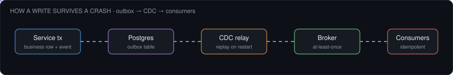
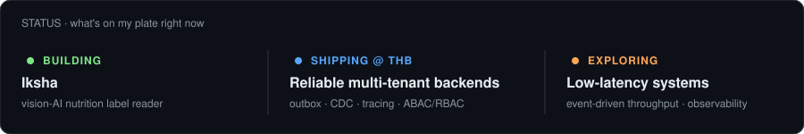

Backend engineer building distributed systems, multi-tenant databases, and backends that stay up when infrastructure doesn't. Currently a **Software Research & Development Engineer at THB**, working on core infrastructure for a multi-tenant healthcare platform, directly with the CTO on architecture.

> 🌐 **More of my work lives at [mrituanjay.tech](https://mrituanjay.tech/)**

---

## ⚡ Impact at THB

 

<b>The full list</b>

- **Crash recovery −97%:** outbox pattern with transaction replay. 30 min of manual SQL audits became 90 s.
- **Migrations in under a minute:** per-tenant filesystem config turned a 4-hour deploy cycle into a config change.
- **MTTR −85%:** distributed tracing across services collapsed a 5-step investigation into one API call.
- **Zero data loss** through Postgres/Redis outages: at-least-once delivery and idempotent semantics.
- **No-code tenant workflows:** a DSL-based engine with ABAC/RBAC policy evaluation, so business teams configure workflows without a release.
- **CDC over polling:** change-data-capture pipelines for transactional consistency across service boundaries.
- **Grew the team:** onboarded 5 senior engineers (3 frontend, 2 backend) onto the system.

---

## 🌟 Featured Project

### 🥗 [Iksha](https://nutrition.myiksha.com) · *Aug '26 – present* · [**Try the live demo →**](https://nutrition.myiksha.com)
`Go` `Echo` `Gemini` `NVIDIA NIM` `PWA` `SQLite` `S3`

A production vision-AI service: photograph a nutrition label, get a plain-language verdict in multiple languages. Built end to end, from architecture to deployment.
- **Two-stage pipeline:** an OCR pre-check rejects non-label images before the expensive model call, then a vision-LLM call is constrained to a JSON schema with validation and fallback.
- **Dual-provider fallback:** Gemini primary, NVIDIA NIM backup, with rate limiting and concurrency tuned per provider.
- **Async persistence:** SQLite + S3 behind a bounded worker pool, so writes never block responses.

## 🧰 Also Built

### 📦 Tally Ops Automation · *Mar '26 – present*
`Python` `pandas` `Tally ODBC` `Telegram Bot API` `Gmail API`

Automation server for a hospital-supplies distributor, in daily production use. It syncs with Tally ERP and pushes low-stock alerts and daily inventory to staff phones, saving ~2 hrs/day.
- **3-tier challan status system** replaced manual Tally lookups that had caused expired, wasted stock.
- **Weekly per-company sales reports**, automated, freeing up a full workday each week.

---

## 🛠️ Stack

---

  

